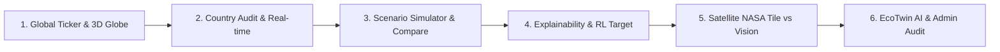
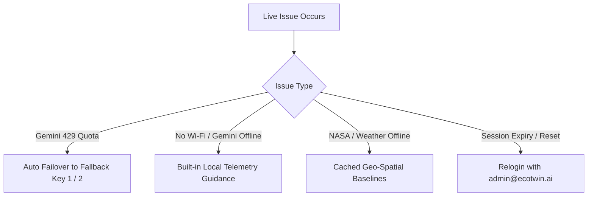

# EcoTwin — Live Hackathon Demonstration Runbook

This runbook provides the exact, rehearsable operational procedures for presenting EcoTwin during live judge demonstrations and technical evaluations.

---

## 1. Prerequisites & Startup Commands

### Environment
- **Node.js**: v18.0.0+ (v20+ recommended)
- **Package Manager**: npm v9+
- **Platform Compatibility**: Tested and verified on Windows PowerShell, macOS, and Linux.

### Startup Options

#### Option A: Local Development Server (Recommended for Live Demo)
Fast hot-reload with SSR and static asset routing:
```bash
npm run dev
```
Accessible at: `http://localhost:5173` (or port indicated in console).

#### Option B: Production Build & Cloudflare Pages Emulation
Validates the compiled Cloudflare Worker SSR bundle (`dist/_worker.js`):
```bash
npm run build
npm run preview
# OR with wrangler
npx wrangler pages dev dist
```

---

## 2. Environment Variables Specification

> [!IMPORTANT]
> Never commit actual secret values to git. The project `.gitignore` ignores `.env`, `.env.production`, and `.dev.vars`.

Create a local `.dev.vars` (or `.env`) file in the workspace root with variable names only:

| Variable Name | Purpose | Sensitivity | Fallback if Omitted |
| :--- | :--- | :--- | :--- |
| `GEMINI_API_KEY` | Primary Gemini API key for EcoTwin AI conversational agent | Secret | Graceful fallback to deterministic environmental guidance & live telemetry |
| `GEMINI_API_KEY_FALLBACK_1` | First secondary key for automatic failover on HTTP 429 quota exhaustion | Secret | Automatically cascades to Fallback 2 or local telemetry fallback |
| `GEMINI_API_KEY_FALLBACK_2` | Second secondary key for high availability | Secret | Local telemetry fallback |
| `GEMINI_MODEL` | Gemini target model (Default: `gemini-1.5-flash`) | Public Config | Defaults to `gemini-1.5-flash` |
| `ECOTWIN_DEV_LOG` | Enables terminal auth OTP logging in dev mode (Default: `true`) | Non-Secret | Suppresses auth debug logs in production |

---

## 3. Rehearsable 3–5 Minute Demo Sequence

Follow this structured, high-impact flow designed to keep judges engaged while highlighting technical depth, data honesty, and resilient design:



### Minute 1: First Impression — Digital Twin & Spatial Earth
1. **Open Dashboard (`/`)**: Show the cyber-eco dark aesthetic, real-time live ticker, and KPI summary cards.
2. **Interact with 3D Globe / Map**:
   - Navigate to the **3D Globe** (`#tab-globe3d`) or **World Map** (`#tab-map`).
   - Drag to rotate the interactive Three.js globe.
   - Click a marker (e.g. Norway, USA, Brazil) to reveal country telemetry, renewable energy percentages, and the **5-Year Trend Projection (Heuristic Estimate)**.
   - Point out the data provenance badges (`Retrieved external data (REST Countries)`).

### Minute 2: Real-time Weather & Physical Scenarios
1. **Live Monitor (`#tab-realtime`)**:
   - Demonstrate the streaming sensor feed, showing live city AQI, temperature, and carbon flux.
   - Highlight the dynamic badge: shows live Open-Meteo weather when online, or graceful deterministic baseline if offline.
2. **Scenario Simulator (`#tab-simulator`)**:
   - Select renewable energy slider (drag from 30% to 85%), lower CO₂ emissions (from 14t to 3t), and click **Run Scenario Projection**.
   - Show the deterministic Plotly confidence envelope (upper/lower bounds) computed over 2025–2035.
   - Note the provenance badge: **Heuristic Multi-Factor Scenario Projection** with fixed random seed ($42$) for scientific reproducibility.

### Minute 3: Intervention Comparison & Explainability (SHAP & RL)
1. **Scenario Comparison (`#tab-compare`)**:
   - Compare "Baseline Grid" against "Accelerated Solar & Transport".
   - Click **Run Comparison** to show dual trajectories, metric delta ($+18.4$ pts), and verified CO₂ savings.
2. **Feature Attribution (`#tab-shap`)**:
   - Click **Explain Prediction** to generate the waterfall decomposition.
   - Explain how each lever (Renewable $+8.2$, CO₂ reduction $+5.4$, Traffic $-2.1$) mathematically sums from the base value ($61$) to the predicted score ($78$).
   - Point out honest methodology attribution: **Additive Feature Contribution (Linear Attribution)**.
3. **Policy Target Optimizer (`#tab-rl`)**:
   - Choose *Gradient Decay* strategy and click **Optimize Policy**.
   - Show iterative convergence curve finding balanced targets without false neural network claims.

### Minute 4: Satellite Remote Sensing & Anomaly Tracking
1. **AI Satellite (`#tab-satellite`)**:
   - Select the **Amazon Rainforest** region.
   - Clearly explain the dual-layer architecture to judges:
     - **Base Tile**: Genuine NASA GIBS VIIRS 250m optical satellite imagery retrieved live from Earthdata.
     - **Detection Overlay**: Synthetic segmentation bounding boxes demonstrating computer vision defect localization.
2. **Anomaly Detection (`#tab-anomaly`)**:
   - Show calendar distribution with rule-based severity thresholding.
   - Highlight the header badge: `Simulated demo data`.

### Minute 5: EcoTwin AI Assistant & Role-Based Security
1. **Ask EcoTwin AI (`#tab-ai`)**:
   - Ask: *"What are the primary factors behind Norway's high sustainability score?"*
   - Show structured response with key insights and follow-up chips.
   - **Explain resilience**: If Gemini rate limits ($429$), it auto-switches to the fallback key; if offline, it immediately falls back to local deterministic telemetry without a crash.
2. **Admin Security Lifecycle (`#tab-admin`)**:
   - Demonstrate access control: visiting `/admin` unauthenticated shows a clean restricted banner.
   - Click **Login**, authenticate as `admin@ecotwin.ai` / `admin123`.
   - Access admin audit table: show user management, verify that passwords (`passHash`) and OTPs are zeroized and never transmitted to the browser.
   - Click **Logout**, verify session revocation.

---

## 4. Live vs Simulated Data Taxonomy

EcoTwin maintains complete honesty about every data stream. Use this table when judges ask about data provenance:

| Module / Endpoint | Data Classification | Implementation Details | Provenance Badge |
| :--- | :--- | :--- | :--- |
| **`/world_data`** | **Retrieved External / Cached** | REST Countries API metadata enriched onto standard World Bank environmental baselines. | `Retrieved external data` |
| **`/realtime`** | **Live External / Graceful Fallback** | Live Open-Meteo weather and air quality API; falls back to deterministic sine-wave models if external API is unreachable. | `Live external API` or `Fallback heuristic` |
| **`/planet_health`** | **Calculated Estimate** | Multi-dimensional weighted composite index aggregating atmospheric, biosphere, hydrosphere, and human systems. | `Calculated estimate` |
| **`/simulate_future`** | **Deterministic Heuristic** | Multi-factor projection model with physical bounds clamping, confidence envelopes, and fixed random seed reproducibility. | `Heuristic result` |
| **`/simulate/compare`**| **Deterministic Heuristic** | Dual-scenario evaluation over a shared 2025–2035 temporal horizon with exact delta accounting. | `Heuristic result` |
| **`/shap/explain`** | **Calculated Estimate** | Linear additive feature contribution decomposition where $\sum \text{contributions} = \text{Score} - \text{Base}$. | `Calculated estimate` |
| **`/rl_optimize`** | **Deterministic Heuristic** | Parameterized gradient-decay multi-objective search algorithm optimizing policy levers towards target scores. | `Heuristic result` |
| **`/satellite/analyze`**| **Hybrid (Genuine Optical + Synthetic Overlay)** | Genuine NASA GIBS VIIRS 250m true-color optical satellite imagery combined with synthetic detection overlays for demonstration. | `Retrieved external (NASA)` + `Simulated overlay` |
| **`/threat_forecast`** | **Retrieved / Baseline** | Live NASA EONET natural event tracking feed with fallback to heuristic risk taxonomy if API rate-limited. | `Retrieved (NASA EONET)` |
| **`/anomaly_data`** | **Simulated Demo Data** | 30-day temporal baseline with synthetic anomalies to illustrate detection pipelines. | `Simulated demo data` |
| **`/ai_query`** | **Live LLM + Local Grounding** | Google Gemini (`gemini-1.5-flash`) with automated multi-key failover and local telemetry fallback grounding. | `Live AI Inference` |
| **`/auth/*`** | **Deterministic Production Cryptography** | Bcrypt password hashing ($10$ rounds), cryptographically secure random session tokens (`et_...`), and time-limited OTPs ($10$ min). | `Security Enforcement` |

---

## 5. Live Demo Fallback & Recovery Strategies

If Wi-Fi drops, API quotas expire, or external servers hang during the presentation, EcoTwin has built-in graceful recovery:



1. **Gemini API Exhausted or Blocked:**
   - The backend automatically switches to `GEMINI_API_KEY_FALLBACK_1`.
   - If all keys fail or Wi-Fi is severed, the chat returns: *"Atmospheric CO₂ is currently 421.5 ppm with 78% water access..."* ensuring the demo never freezes or throws unhandled errors.
2. **NASA GIBS Tile Unreachable:**
   - The satellite viewer automatically loads the cached high-resolution MODIS Terra fallback tile.
3. **Open-Meteo Weather Unavailable:**
   - Sensor streaming immediately uses the deterministic trigonometric diurnal cycle, preserving live charts.

---

## 6. Known Limitations & Technical Judge Q&A

### Q1: "Is this a real LSTM or deep reinforcement learning model?"
> **Answer:** *"No, and we are completely transparent about that. For live web demonstration stability and verifiable execution on edge runtimes, we implemented deterministic multi-factor projections and parameterized gradient-decay heuristics. Rather than faking neural network weights with static random numbers, our models enforce physical bounds (non-negative emissions, bounded percentages) and mathematically provable feature attribution where contributions equal the score delta."*

### Q2: "How does authentication scale on Cloudflare Workers edge isolates?"
> **Answer:** *"For this hackathon demonstration, sessions and users are managed in-memory with Bcrypt and secure tokens to allow instantaneous local review without external database dependencies. In a distributed multi-region Cloudflare deployment, memory is isolate-local; production persistence would bind to Cloudflare D1 (relational) or Cloudflare KV (session store). We explicitly document this isolate limitation rather than claiming unbacked global persistence."*

### Q3: "How do you distinguish genuine satellite data from simulated overlays?"
> **Answer:** *"We fetch actual optical imagery tiles from NASA's GIBS VIIRS WMTS service at 250m resolution. However, the bounding box segmentation overlays are synthetic demonstration vectors. Our UI and API provenance metadata explicitly separate the two layers (`opticalImagery: NASA VIIRS`, `visionOverlays: Simulated demo data`) so users are never misled."*

### Q4: "Where are Gemini API keys stored and executed?"
> **Answer:** *"All API keys are strictly confined to the backend Cloudflare Worker environment. Client code only interacts with `/ai_query` via JSON payloads. Keys are never transmitted to the browser, never injected into Vite client defines, and sanitized from all error responses."*

---

## 7. Pre-Demo Checklist

Run this 60-second verification before stepping up to present:

- [ ] Run test suites:
  - `node test_security.js` (Must pass 46/46)
  - `node test_part3.js` (Must pass 45/45)
  - `node test_part4.js` (Must pass 98/98)
  - `node test_part5.js` (Must pass 81/81)
- [ ] Run `npm run build` (Must succeed without errors, SSR bundle under 200 kB).
- [ ] Verify `npm run dev` starts cleanly on `http://localhost:5173`.
- [ ] Ensure browser is in normal window or presentation mode (1080p recommended).
- [ ] Verify test credentials ready:
  - **Admin**: `admin@ecotwin.ai` / `admin123`
  - **Analyst**: `analyst@ecotwin.ai` / `demo123`
- [ ] Open browser developer tools Console tab: verify zero uncaught exceptions.
